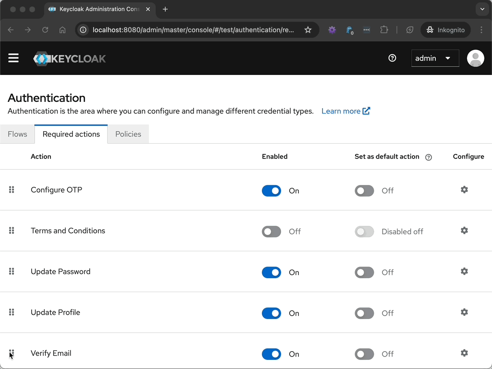

# Periodic Email Verification

Makes users re-verify their email address periodically, after a configurable duration since the last verification.

## Components

### Periodic Verify Email Action

The `PeriodicVerifyEmail` action extends and automatically overloads the built-in required action `VERIFY_EMAIL`.

It tests periodically if a user has to re-verify its email address.
To configure the duration how often a user has to re-verify the email, see here:



The periodic verification applies to users whose email address is verified, independent of the realm setting _Verify email_.

Users whose email address is not verified (e.g. newly registered users, or users whose address has been changed) are handled like by the built-in action:
whether they have to verify their address is decided by the realm setting _Verify email_ (_Realm settings_ → _Login_).
If this setting is off, these users are not asked for a first verification, even if the periodic verification is switched on.
A `VERIFY_EMAIL` action set explicitly for a user (e.g. by an administrator) is completed only by verifying the email address.

### Extended Verify Email Action Token Handler

The `ExtendedVerifyEmailActionTokenHandler` extends and automatically overloads the built-in action token handler.

It adds setting the `emailVerifiedAt` attribute to the current timestamp when the user confirms/verifies its email via the action token link.

## User Profile Configuration

The time of the last verification is stored in the user attribute `emailVerifiedAt` (epoch milliseconds), which decides when the next verification is due.
Make sure that users cannot change this attribute themselves, otherwise they could postpone the verification.

Declare the attribute in the user profile of the realm (_Realm settings_ → _User profile_ → _JSON editor_), so that only administrators can view and edit it,
by adding this entry to the `attributes` array:

```json
{
  "name": "emailVerifiedAt",
  "permissions": {
    "view": ["admin"],
    "edit": ["admin"]
  }
}
```

Do not set the _Unmanaged Attributes_ setting of the realm to _Enabled_ (e.g. as a result of a migration from a Keycloak version before 24),
as this allows users to edit all attributes that are not declared in the user profile, including `emailVerifiedAt`.
The extension writes the attribute directly on the user, so it works with a declared as well as with an undeclared attribute.

## Limitations

The periodic verification is evaluated only when a user authenticates, i.e. as part of the login.
Existing sessions, as well as refresh and offline tokens, are not checked again by Keycloak.
A user with a long-living session or token can therefore stay signed in beyond the configured verification period, without being asked to verify the email address.

Choose the session lifetimes (e.g. SSO session max, offline session settings) to match the configured verification period.

The periodic verification is suspended for users of a read-only user storage, i.e. a user federation (e.g. LDAP) with the edit mode `READ_ONLY`.
Keycloak rejects writing the `emailVerifiedAt` attribute for such users, so the time of the last verification cannot be stored.
For these users the behavior of the built-in `VERIFY_EMAIL` action applies.
